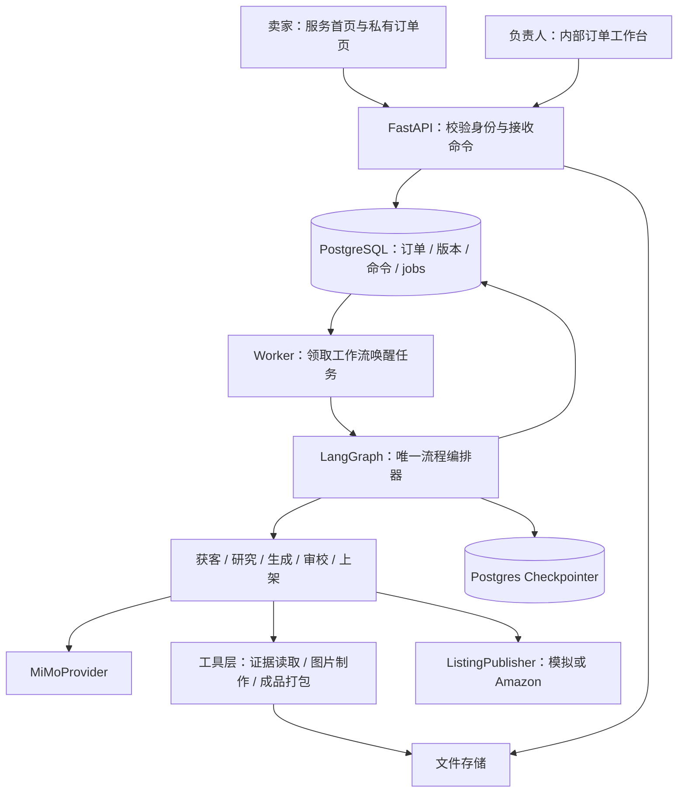
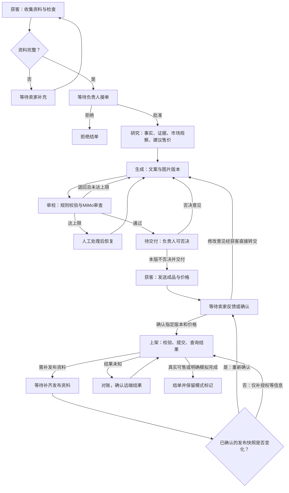

> 最新获客策略：实际图片与受限公开页面参与初审，取消固定四类参数和逐项核实门槛；接单前展示初审与文案方向，负责人素材只读。见[AGENT_INPUT_STRATEGY.md](AGENT_INPUT_STRATEGY.md)。

> 当前实现修订：建单五项输入、原文候选核实和商家卖点策略见[AGENT_INPUT_STRATEGY.md](AGENT_INPUT_STRATEGY.md)。订单演示模式与重复身份列、工时表及人工写证据/启动生产API已删除；模拟Amazon仍独立标注。

# AI 电商运营公司：首版工程架构

日期：2026-11-07。本文是基于现有五份资料的实施设计，目录和接口均为拟建内容，尚未实现业务代码。

分阶段任务、具体文件、启动命令与验收约定见 [开发执行计划](DEVELOPMENT_PLAN.md)。架构目录表示最终模块边界，实际文件按计划逐步创建；后端测试放在 `apps/server/tests`，前端端到端测试放在 `apps/web/e2e`。

## 1. 定位与架构决策

首版产品是一家面向中文跨境小卖家的“Amazon 美国站商品本地化上架服务公司”。限定非电子桌面收纳用品、单次一个 SKU、美式英语，交付文案、商品图片、FAQ、商品建议售价，并在卖家确认后执行上架。负责人负责接单决策、交付否决与人工客服，五个 MiMo Agent 分工执行。

设计依据是 `PROJECT_OVERVIEW.md` 的明确范围和 `流程图.png` 的交接关系；`agent框架.pdf` 提供组织草图，角色名称和流程细节采用前两者。编排采用 `MiMo-Agent-Examples.md` 中的串行流水线、审校循环和人机协作模式。

**核心选择：单仓库、模块化后端、订单驱动、持久化工作流。五个 Agent 是五种有明确输入输出和工具权限的处理器，共用一个 MiMo 适配层。** 首版不拆微服务，不增加主管 Agent，不做自主群聊。

| 层 | 首版选择 | 解决的问题 |
|---|---|---|
| 前端 | Next.js + TypeScript | 一个项目包含服务首页、卖家订单页和内部工作台，分别提供布局和权限 |
| API | Python + FastAPI + Pydantic | 资料收集、订单访问、审批命令、结构校验和文件交付 |
| 流程编排 | LangGraph，显式节点与条件边 | 串行交接、生成审校循环、等待补充/审批/确认、失败恢复 |
| 执行进程 | 同一后端代码中的独立 worker | 接手长任务，运行到等待点后释放资源，避免 HTTP 请求一直等待 |
| 数据 | PostgreSQL + SQLAlchemy + Alembic | 订单、证据、成品版本、执行记录、命令和工作流检查点 |
| 模型 | MiMo-V2.6-Pro，OpenAI 兼容客户端 | 五个角色共享连接管理、超时、用量与结构化输出校验 |
| 文件 | 存储接口；本地开发用目录，部署用对象存储 | 隔离附件和成品，保存不可变版本；为真实刊登提供平台可抓取图片 |
| 本地运行 | Windows/macOS原生运行，本机安装PostgreSQL | web、api、worker共用代码；Docker不作为本机开发依赖 |

这是针对比赛周期的推荐选型；具体依赖版本在初始化时验证兼容并锁定。首版无需 Redis、向量数据库、Kubernetes 或通用 Agent 平台。进度先用短轮询，确有需要再加 SSE。

跨平台要求为同一源码在Windows/macOS安装依赖后启动网页应用，操作系统差异集中在路径、进程管理及环境安装，业务代码不分叉；需分别实测，不能仅凭框架跨平台宣称通过。Docker是可选的环境管理与部署方式，不是模型调用或运行本项目的必要条件。现已具备MiMo API Key，下一阶段从后端配置读取并做真实接入验证。

用户已选本机原生安装PostgreSQL作为开发方案；业务库和测试库分别创建。其他Windows机器需具备Node/npm、uv管理的Python以及数据库服务；依赖库由锁文件安装。详细环境清单和后续检查脚本见开发执行计划。

## 2. 系统结构与职责



前端呈现状态、收集输入和提交动作；API 校验身份、当前版本和动作是否允许。Agent 生成业务判断、内容和工具请求，不能任意修改订单阶段。流程节点通过应用服务提交合法状态迁移。

**只保留一个编排器。** `jobs` 表只保存 `START / RESUME / RETRY / RECONCILE` 等唤醒任务，不独立安排研究、生成、审校的下一步。worker 调用 LangGraph，图运行到持久化等待点或结束后退出本次任务。所有后续节点由图的显式边控制。

业务表是订单、证据、决定和成品的事实来源；checkpoint 保存执行位置和产物引用，不充当另一套商品数据库。流程恢复必须核对业务版本，不能凭旧 checkpoint 重复执行交付或发布。

## 3. 拟建项目目录

```text
HackJunction/
├── README.md                         # 启动、配置、演示入口
├── .env.example                      # 配置模板，不包含真实密钥
├── .gitignore
├── compose.yaml                      # 仅未来选用容器部署时提供，不是本机启动前提
├── docs/                             # 保留现有赛题、需求与流程图
│   ├── IMPLEMENTATION_ARCHITECTURE.md
│   └── DEMO_RUNBOOK.md                # 待建：演示步骤、真实/模拟边界
├── apps/
│   ├── web/
│   │   ├── package.json
│   │   ├── src/app/
│   │   │   ├── (public)/page.tsx      # 服务介绍、样例、询单入口
│   │   │   ├── (seller)/orders/new/page.tsx
│   │   │   ├── (seller)/o/[orderId]/page.tsx
│   │   │   └── (internal)/internal/   # 登录、订单列表、订单详情
│   │   ├── src/features/
│   │   │   ├── intake/               # 对话、结构化商品资料、补充资料
│   │   │   ├── orders/               # 订单进度、附件、人工客服
│   │   │   ├── deliverables/         # 版本对比、复制、下载、确认
│   │   │   └── operations/           # 审批、证据、执行轨迹、重试
│   │   ├── src/components/           # 通用UI组件
│   │   └── src/lib/                  # API客户端、认证、生成的接口类型
│   └── server/
│       ├── pyproject.toml
│       ├── uv.lock
│       ├── alembic/
│       └── src/company/
│           ├── main.py               # API启动入口
│           ├── worker.py             # worker启动入口，同一份Python包
│           ├── config.py
│           ├── api/                  # seller、internal、access、assets路由
│           ├── domain/               # 状态、实体、价格/版本规则、错误类型
│           ├── schemas/              # 业务输入输出与Agent产物契约
│           ├── services/             # 订单、审批、事实、版本、交付、发布服务
│           ├── workflows/
│           │   ├── graph.py          # 流程节点、条件边、等待与恢复
│           │   ├── state.py          # 图状态：ID、revision、产物引用
│           │   └── nodes.py          # 连接Agent与应用服务
│           ├── agents/
│           │   ├── acquisition.py
│           │   ├── research.py
│           │   ├── generation.py
│           │   ├── review.py
│           │   └── publishing.py
│           ├── prompts/              # 五个角色的可版本化提示词
│           ├── tools/                # 经授权的证据读取、图片制作、ZIP打包
│           ├── providers/
│           │   ├── mimo.py           # 模型、JSON校验、工具循环、用量
│           │   ├── images.py         # 图片制作接口与首版实现
│           │   ├── storage.py        # 本地/对象存储实现
│           │   └── publishers/
│           │       ├── base.py
│           │       ├── simulated.py
│           │       └── amazon.py
│           └── persistence/          # 表、事务、repositories、jobs、checkpointer
├── fixtures/demo/                    # 明确标为虚构的SKU、图片、竞品观察
├── scripts/                          # 演示数据初始化、契约导出
└── var/                              # 本地运行产物，忽略入库
```

目录先建到实际需要的层级，不预先生成大量空类。`apps/server/tests/workflow`、`apps/server/tests/integration` 分别放流程与集成测试，`apps/web/e2e` 放页面端到端测试。前后端通过 FastAPI 的 OpenAPI 契约对齐，前端类型由契约生成，避免手工维护两份字段定义。Python 内部通过函数和结构化对象交接，无需 Agent 之间互相发 HTTP 请求。

## 4. 订单状态与五 Agent 工作流



数据库中订单 `phase` 至少覆盖 `INTAKE / NEEDS_INFO / AWAITING_ACCEPTANCE / RESEARCH / GENERATION / REVIEW / AWAITING_RELEASE / AWAITING_SELLER / READY_TO_PUBLISH / NEEDS_PUBLISH_INFO / PUBLISHING / COMPLETED / REJECTED`。任务是否失败使用独立的 `run_status`，保留失败前的业务阶段；人工升级用带原因的待办记录表示，不把所有异常都塞进一个含糊的“失败订单”。

四条执行规则必须先固定：

- **人工等待要真正暂停。** 补资料、接单、交付放行、卖家确认均保存状态后中断，外部命令到来再恢复。不得轮询模型等待人回复，也不得让 HTTP 请求挂住。
- **未否决有明确生效事件。** 原需求没有规定观察时限。首版建议负责人点击“本版不否决并交付”后再由获客 Agent 发出；这是待交付闸门的具体交互约定，需要团队确认，不能无声改成自动立刻交付。后续若改为限时否决，需增加可审计的截止时间与竞态处理。
- **所有返修形成新版本。** 审校退回、负责人否决、卖家反馈分别保存原因，再交生成 Agent。卖家反馈仍直接进入生成；若涉及材质、尺寸等事实变化，先由事实校验服务确认并使旧研究/审校结果失效，必要时重新研究。
- **循环有预算。** 建议每次生成审校回合最多自动返修 3 次，超限交人工；不同轮卖家反馈单独计数，同时设置每单总用量和总轮数上限，防止无限循环。这是可配置工程默认值，不代表已承诺的商业修改次数。

用户请求人工客服建立 `SupportTicket`，在同一订单内记录接管和恢复。接管期间暂停自动对话回复；如需暂停生产流程，负责人明确选择暂停，避免每次咨询都意外停工。

## 5. Agent 输入、输出与权限

| Agent | 输入 → 结构化输出 | 可用工具与限制 |
|---|---|---|
| 获客 | 卖家消息和资料 → `IntakeResult`、补充请求、交付消息、反馈单 | 读写本单对话、提出资料更新、请求交付；不能自行批准接单或改写成品 |
| 研究 | 已确认资料、附件、已有带来源证据 → `ResearchPackage` | 读取本单证据、图片理解；首版不自动抓取竞品，不虚构实时调研 |
| 生成 | 研究包、基础版本、返修意见 → `ListingDraft`、`ImagePlan`、图片资产 | 读已核准事实、调用图片制作工具、保存草稿；不能交付或发布 |
| 审校 | 指定草稿、事实证据、规则版本 → `ReviewReport` | 读取文案和图片、规则检查；不通过必须给字段位置、问题、证据缺口和修复建议 |
| 上架 | 已确认快照、发布资料、授权状态 → `PublishPlan`、执行结果摘要 | 仅能请求发布网关操作；网关再次校验版本、价格、权限，实际结果由平台响应决定 |

每个 Agent 的实现由“提示词 + Pydantic 产物模型 + 允许的工具 + 执行预算”组成，共用 `MiMoProvider`。程序核验模型返回的工具名称、参数和当前阶段，再执行工具；不向模型暴露任意 SQL、shell 或全局文件读写。

关键产物约定：

```text
ProductFact = id, key, value, unit, source_ids, confirmation_status, revision
Evidence = id, kind, source_url/asset_id, observed_at, content, is_demo
ResearchPackage = fact_revision, confirmed_facts, observations, questions,
                  market_notes, suggested_listing_price_range, pricing_evidence_ids
ListingDraft = version_id, input_snapshot_id, title, bullets[5], description,
               faqs[], image_asset_ids[], claims[{field_path, text, fact_ids}]
ReviewReport = version_id, ruleset_version, passed,
               issues[{field_path, severity, reason, evidence_ids, suggested_fix}]
SellerConfirmation = version_id, content_hash, asset_hashes, listing_price,
                     currency, seller_sku, marketplace, fulfillment_snapshot, confirmed_at
```

卖家确认事实、图片观察、竞品事实分开存储。图片观察不能自动升级为本商品事实，竞品的适配、认证或材质不能挪用到本商品。声明关联事实 ID，同时检查关联证据能否实际支持声明；“有引用”本身不代表声明正确。

`suggested_listing_price_range` 是商品建议售价；`service_quote` 是公司服务报价，分字段记录。二者均不引入在线支付。缺少竞品依据时允许返回“无法形成可靠价格区间”，由负责人补证据后继续。

## 6. 数据、版本与可靠执行

| 表/实体 | 首版应保存的内容 |
|---|---|
| `orders`、`order_access` | 阶段、市场、语言、来源渠道、是否模拟、revision、访问令牌摘要 |
| `messages`、`feedback`、`support_tickets` | 卖家/Agent/人工消息、意见来源、接管状态及负责人处理耗时 |
| `assets`、`evidence`、`product_facts` | 附件、来源、观察时间、确认状态、文件哈希与事实修订 |
| `research_packages` | 输入依赖快照、市场观察、建议售价与依据 |
| `deliverable_versions`、`review_reports` | 不可变文案和图片集合、父版本、审校问题、规则版本 |
| `human_decisions`、`seller_confirmations` | 接单、否决、交付放行、具体成品版本与确认快照 |
| `publish_attempts` | 模式、快照、远端请求ID、SKU、提交/处理/可售状态、错误 |
| `agent_runs`、`tool_calls` | 角色、输入输出引用、prompt/model版本、耗时、用量、重试、脱敏错误 |
| `commands`、`jobs`、`order_events` | 幂等命令、待运行任务、租约、订单级执行锁、可重放的可见事件 |
| LangGraph checkpoint 表 | 同一订单的执行位置和状态引用，由框架管理 |

成品不可原地覆盖：`v1 → v2 → v3` 分别保存，审校、否决和确认都绑定版本。任何文案、图片、商品售价、库存或履约等发布关键字段改变，都使对应发布确认失效，必须展示变更并重新确认。建议对完整发布快照计算哈希，发布网关只接受确认过的哈希。

可靠执行按以下边界实现：

1. API 将带幂等键的命令和唤醒 job 在同一事务写入，返回 `202`。同一命令重发不重复生效；非法阶段或过期版本返回 `409`。
2. 首版一个 worker，数据库仍保证同一订单只有一个有效执行租约；租约代次和预期订单 revision 在结果提交时核验。模型调用期间不持有数据库长事务。
3. 节点产物、订单变化和可见事件在同一事务落库；checkpoint 随后保存游标。若此时进程崩溃，节点恢复时读取已提交结果，不再次交付或创建相同成品。
4. 节点执行键包含订单、事实/证据修订、基础成品、返修意见和 prompt/model 配置的依赖摘要。过期输入的结果拒绝提交。首版只保存阶段执行凭据，不做通用缓存平台。
5. 限流、临时网络错误可有限退避重试；JSON结构失败可有限修复；业务缺资料进入等待；审校不通过进入返修。发布结果未知单独进入对账，不能复用普通重试策略。

同一订单使用稳定的 LangGraph `thread_id`，等待点使用持久化 checkpointer 与 `interrupt`，通过经校验的 `Command` 恢复。中断节点会重新进入执行，因此等待前后的文件写入、交付和工具副作用必须拆成可幂等核对的节点；恢复载荷只引用已落库的命令，不能直接信任前端提交的状态。

跨数据库和外部平台无法靠一个事务保证执行一次。目标是任务可重复领取、业务结果不会重复提交、外部副作用可核对，而不是承诺端到端“绝对只执行一次”。等待命令的投递可从 `commands` 表恢复，不能只依赖内存队列。

## 7. 页面、API 与访问控制

卖家端以订单为主线：服务与演示样例 → 注册验证邮箱/登录 → 五项商品建单 → 我的订单/订单进度 → 补充并核实资料 → 查看成品及建议售价 → 修改/确认 → 发布结果。建单商家身份由后端从账号读取，原始明细与参考链接保存在订单中；链接不自动抓取，自由文本不等同于已核实事实。文案字段可复制，交付包可下载，人工客服入口始终可见。

内部端首页先展示“待我处理”：接单申请、待交付版本、人工客服、失败任务。订单详情包含资料与证据、Agent 运行时间线、版本对比、审校问题、用量、批准/拒绝/否决/交付和重试操作。首版同一负责人使用；以后再细分开发诊断与业务审批权限。

建议接口均以 `/api/v1` 为前缀：

| 接口 | 用途 |
|---|---|
| `POST /seller/auth/verification-code` | 向注册邮箱发送一次性验证码，使用 QQ SMTP；带有效期、发送限频和尝试次数限制 |
| `POST /seller/auth/register`、`POST /seller/auth/login`、`GET /seller/auth/session`、`POST /seller/auth/logout` | 卖家账号与会话 |
| `GET /seller/orders` | 分页查询当前卖家订单 |
| `POST /orders` | 登录并校验CSRF后建订单，自动绑定当前卖家账号 |
| `POST /order-access/exchange` | 校验链接；账号订单仍须匹配登录账号，链接不授予其他卖家权限 |
| `GET /orders/{id}`、`GET /orders/{id}/events?after=...` | 卖家可见摘要与增量进度；首版轮询 |
| `POST /orders/{id}/messages`、`POST /orders/{id}/supplements` | 对话、补资料与事实修订请求 |
| `POST /orders/{id}/assets` | 授权上传附件，校验大小与实际文件类型 |
| `GET /orders/{id}/deliverables`、`GET /orders/{id}/download` | 仅返回已交付版本及其下载包 |
| `POST /orders/{id}/feedback`、`POST /orders/{id}/confirmations` | 针对明确版本提交修改意见或发布确认 |
| `POST /orders/{id}/support-requests` | 请求人工处理 |
| `GET /internal/orders`、`GET /internal/orders/{id}` | 内部待办、附件、证据和执行详情 |
| `POST /internal/orders/{id}/decisions` | 接单/拒绝/否决/不否决并交付，带版本与理由 |
| `GET /internal/orders/{id}/evidence` | 只读查看Agent采用的已有来源证据 |
| `POST /internal/orders/{id}/retries` | 对指定失败运行发出受控重试命令 |
| `POST /internal/support-tickets/{id}/messages` | 人工客服回复，留操作者记录 |

卖家需通过邮箱验证码注册，再使用邮箱密码登录。密码8–18位、字母/数字/符号至少两类，验证码不回传浏览器接口、不记日志；数据库存带密钥摘要，10分钟失效、60秒重发间隔、最多5次错误。QQ SMTP 通过本机配置读取授权码并验证TLS证书。订单绑定 `seller_accounts.id`；账号密码使用 Argon2 摘要，账号会话独立于负责人会话。所有新订单的创建、资料写入与文件访问由后端验证当前账号归属，写操作校验 CSRF；订单ID和完整链接都不能代替账号权限。登录会话使用 HttpOnly/SameSite cookie，生产设置 Secure 并使用 HTTPS。同源部署，账号会话默认7天，负责人默认12小时；退出撤销当前会话。旧订单不做认领，本机旧数据已单次清理，常规迁移不删数据。

API 每次校验订单归属；附件与下载也必须授权。内部端单独认证，卖家响应使用明确的公开字段白名单，不能直接序列化内部订单对象。日志隐藏令牌、密钥和卖家敏感信息；外部资料作为待分析数据，不得改变工具权限。

## 8. MiMo、图片与 Amazon 接入

### MiMo

官方 OpenAI 兼容配置为 `base_url=https://api.xiaomimimo.com/v1`、`model=mimo-v2.6-pro`。比赛提供的专用地址、额度和权限若不同，通过配置覆盖，开发第一阶段先做实际连通测试。

`MiMoProvider` 统一提供结构化生成、图片理解和受控工具循环。JSON 模式仍需 Pydantic 校验字段、类型及业务约束；不假定所有 OpenAI 参数都兼容。当前官方 `tool_choice` 仅支持 `auto`，必须执行的检查和状态迁移由程序调用，不能赌模型一定选择指定工具。每次调用记录模型实际返回的用量，单价和成本估算规则独立配置。

官方模型规格为多模态输入、文本输出。MiMo 负责理解商品、生成文案、规划图片并调用工具，图片资产由独立 `ImageProvider` 制作。运行轨迹展示任务摘要、工具调用、证据和产物；模型协议需要的内部续接字段由 provider 处理。

### 图片

首版建议使用卖家真实商品参考图，结合经核实的尺寸/卖点做确定性排版，输出主图候选和信息图；主图与附图使用不同模板和规则，实际规则在实现时核对官方来源并版本化。外部生图或编辑服务作为可替换实现，先验证可用再接入。

资料输入时图片仍可选；进入需要还原外观的图片交付阶段，缺少可核实参考则请求补图。虚构演示 SKU 可用明确标记的模拟素材，真实商品不能把概念图当实拍图。审校必须读取实际图片，检查图文声明与商品一致性，不能只审查图片提示词。

交付包建议包含 `listing.json`、可复制的文案文件、`faq.md`、`pricing-notes.md`、图片目录和版本清单。内部完整证据、敏感资料、模型诊断另外保存，不随 ZIP 自动导出。

### Amazon

定义 `ListingPublisher.validate(snapshot)`、`submit(snapshot)`、`get_status(attempt)` 三个接口，实现 `SimulatedPublisher` 和 `AmazonPublisher`。`publishing.py` 使用 MiMo 辅助字段映射和问题解释，实际校验、提交和结果判定通过发布网关完成；状态不会由模型文本直接认定。

真实发布先解决卖家授权、应用角色、商品类型 schema、商品身份/品牌、适用的 GTIN 或豁免、商品价格、库存/履约和可抓取图片等要求。“足以生成内容”与“足以发布”分别校验。不能把服务方自己的私有应用授权直接当成所有卖家的授权。

发布尝试至少区分：

```text
BLOCKED_MISSING_DATA → READY → SUBMITTING → ACCEPTED_PROCESSING → PUBLISHED
                                  └→ UNKNOWN → RECONCILING
另有 VALIDATION_FAILED / ACTION_REQUIRED / FAILED / SIMULATED
```

`ACCEPTED` 只代表提交被接收，后续轮询查询平台问题与状态。首版真实“上架成功”建议定义为本次提交已处理、确认快照中的关键内容与价格已生效，且目标 marketplace 的该 SKU 同时满足可发现和可购买、无阻断问题；未满足保持待处理。已有 SKU 可售可能来自旧版本，不能据此认定本次发布成功。发布前持久化快照与 attempt；请求超时后按卖家、SKU、市场、本次提交标识与关键字段核对远端状态，无法确认时继续待核对，不能直接重新提交。

模式分别为 `simulated / sandbox / production`，订单、页面、日志和指标都保留标记。模拟模式产出明确标识的演示商品页及发布回执，结局显示“模拟订单完成”；它不等于 Amazon 上架，真实模式缺凭据时也不能静默降级模拟。官方沙箱用于接口验证，不能产生真实可售商品。完整真实发布是独立接入里程碑，在凭据具备时尽早验证。

模拟闭环是开发阶段成果，不替代 `PROJECT_OVERVIEW.md` 要求的真实上架；未通过真实发布验收时，该项功能应明确标为未完成。具体依赖与验收顺序见开发执行计划中的里程碑 R。

## 9. 从零实施顺序与比赛验收

按约 40 小时有效开发窗口安排，时间是建议预算，实际依比赛进度调整：

| 阶段 | 预算 | 必须得到的可验证成果 |
|---|---|---|
| 0：外部能力验证 | 0–3h | MiMo文本/图片/JSON/工具调用试通；明确图片来源、Amazon权限和发布模式 |
| 1：最小纵向链路 | 3–10h | 首页提交 → 保存订单与私有链接 → 内部接单 → 真实MiMo生成并内部预览；卖家先查看进度，完整审校和放行后才可见成品；部署可访问地址 |
| 2：五Agent产线 | 10–22h | 资料补全、证据研究、图片产物、审校返修、交付否决闸门、用量与轨迹；五角色接入真实MiMo |
| 3：业务闭环 | 22–31h | 卖家反馈、再次审校、版本与价格确认、下载包、模拟发布闭环、人工客服及失败恢复；有授权则并行打通真发布 |
| 4：验证与营业 | 31–40h | 分支验收、线上稳定性、真实询单记录、服务报价假设、单均成本、三分钟演示与局限说明 |

多人开发可按 web、工作流/Agent、数据/API/发布接入分工；开始前先统一契约和版本规则。若只有一名开发者，按纵向链路推进，首个可用订单出现后再扩分支。真实获客应在首个线上版本上线后即开始，记录询单和反馈；不能等最后才补一个营销页面。

验收使用需求文档中的虚构桌面理线夹，依次证明：缺资料请求补充 → 人工批准 → 带来源研究与定价 → 注入无依据适配声明被退回 → 新版本审校通过 → 放行交付 → 卖家修改 → 再审 → 确认指定版本与售价 → 发布并按模式结单。另验拒绝接单、负责人否决、转人工、worker重启恢复、重复确认、旧版本禁止发布与发布超时对账。

以上对应必要的工作流、接口和端到端测试；模型结果用结构、事实支持及审校效果验收，不用逐字匹配。故障注入只在演示/测试模式启用。模拟数据、真实询单和真实成交分别统计。

经营记录至少包括来源渠道、询单数、接单数、交付/发布数、服务报价、商品售价、模型及图片调用成本、返修次数和卖家反馈。MiMo赠送额度也按配置单价估算可持续成本。以这些数据支撑商业化潜力，以来源和版本证据支撑原创性与完成度；首版不包含在线支付、自动竞品抓取、多平台、多语言和社媒发布。

## 10. 已核对的官方技术依据

- [MiMo-V2.6-Pro：输入输出模态、模型ID与接入示例](https://mimo.mi.com/models/zh-CN/mimo-v2.6-pro)
- [MiMo OpenAI兼容Chat Completions：工具调用与参数约束](https://mimo.mi.com/docs/zh-CN/api/chat/openai-api-post)
- [MiMo结构化输出：JSON模式与应用侧校验](https://mimo.mi.com/docs/zh-CN/quick-start/usage-guide/text-generation/structured-output)
- [LangGraph中断与恢复：checkpointer、thread_id、Command](https://docs.langchain.com/oss/python/langgraph/interrupts)
- [LangGraph持久化：生产持久化检查点与数据库支持](https://docs.langchain.com/oss/python/langgraph/persistence)
- [Next.js路由分组：同一项目组织不同端页面](https://nextjs.org/docs/app/api-reference/file-conventions/route-groups)
- [Amazon刊登工作流：商品类型schema、提交与异步状态](https://developer-docs.amazon/sp-api/docs/building-listings-management-workflows-guide)
- [Amazon媒体提交：授权、角色与可抓取图片](https://developer-docs.amazon/sp-api/docs/submit-media)
- [Amazon沙箱说明](https://developer-docs.amazon/sp-api/docs/sp-api-sandbox)

本文给出可执行的工程框架，不代表现有功能已经实现。当前需要团队确定的产品约定只有：待交付闸门是否采用显式放行、真实商品图如何取得，以及比赛期间能否取得真实 Amazon 卖家授权；这些差异已通过交付规则与适配器隔离，不妨碍先开发核心订单流程。
