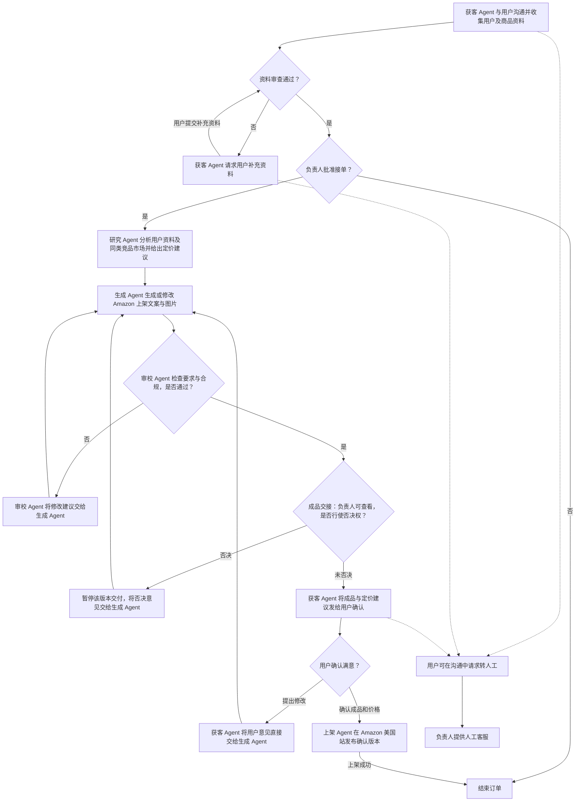

# 跨境商品本地化上架包｜需求概要

我们是一家为跨境小卖家提供上架文案服务的一人公司。首版面向准备在 Amazon 美国站销售非电子类桌面收纳用品的中文卖家。卖家提交一个商品的资料，由获客、研究、生成、审校和上架五个 MiMo Agent 分工处理，交付可直接用于 Amazon 美国站上架的美式英语文案与商品图片。公司负责人审批接单、处理人工客服，并可否决待交付成品。

## 用户输入与交付输出

| | 内容 |
|---|---|
| 必填输入 | 用户资料、中文商品名、卖家确认的商品事实，例如材质、尺寸、包装数量、适用范围。首版固定 Amazon 美国站、美式英语，单次提交一个 SKU。 |
| 可选输入 | 已有商品图、原上架文案、希望强调的卖点。图片观察和用户希望强调的卖点需要事实支持。 |
| 过程输入 | 负责人可以补录带来源的竞品观察；卖家收到补充请求后可以补资料，交付后可以反馈。 |
| 交付输出 | 英文商品标题、五点卖点、详情文案、买家 FAQ；可用于上架的商品图片。文案字段可复制，整包可下载。FAQ 和定价建议是配套资料。 |
| 内部输出 | 商品事实与来源、待确认项、文案与证据的对应关系、审校问题、版本历史、运行耗时和模型用量。 |

**最终效果：**卖家提交资料后拿到订单链接，用同一个入口查看进度、补资料、下载成果和反馈。公司负责人能看到每一步是谁做的、有哪些事实待核对、为何批准了这一版。交付的是可供卖家确认和使用的文案与图片，卖家确认成品和价格后，由上架 Agent 发布到 Amazon 美国站。服务不承诺排名或销量。

## 两个前端

| 前端 | 谁使用 | 首版功能 |
|---|---|---|
| 卖家端 | 潜在客户、已下单卖家 | 查看服务与演示样例、提交商品资料、通过私有订单链接查看进度、补资料、复制已交付文案、下载上架包、提出修改意见、确认满意或请求人工客服。无需注册。 |
| 公司内部端 | 公司负责人、授权内部开发人员 | 查看订单和附件、Agent研究依据及中间产物，查看失败原因与用量并授权技术恢复，审批接单、查看或否决待交付成品、处理人工客服。开发人员需要查看运行状态与脱敏诊断；成品由获客 Agent 发送给卖家确认。 |

两个前端共享同一个后端和订单状态。卖家只能查看自己的公开订单信息和已交付版本。首版内部端优先满足运营和调试，可先由同一名负责人操作；需要多人登录时，再拆分开发人员和审批人员权限。

## 一人公司：1 名负责人 + 5 个 MiMo Agent

| 角色 | 职责 |
|---|---|
| 获客 Agent | 与用户沟通并收集用户及商品资料。资料审查未通过时请求补充并重新审查，通过后提交负责人审批。收到审校通过且未被否决的成品后，连同定价建议发送给用户确认。收到修改意见时直接转交生成 Agent。用户确认成品和价格后，将确认版本交给上架 Agent。 |
| 公司负责人 | 审批接单，批准后启动研究，拒绝则结束订单。负责用户请求的人工客服。在审校 Agent 向获客 Agent 交接成品时可查看该版本，并有一票否决权。被否决版本暂停交付，由生成 Agent 根据否决意见修改，再次送审。 |
| 研究 Agent | 分析用户提供的资料和同类竞品市场，将商品事实、来源、待确认项、市场洞察及定价建议交给生成 Agent，并记录建议价格区间及其竞品依据。区分卖家确认的事实、图片观察与竞品信息。 |
| 生成 Agent | 根据研究结果和用户要求生成可直接用于 Amazon 美国站上架的文案与商品图片，直接提交审校 Agent。根据审校意见、负责人否决意见或用户反馈修改后再次送审。 |
| 审校 Agent | 检查文案和图片是否满足要求、关键声明是否有依据，以及是否存在违规内容。未通过时将具体修改建议交给生成 Agent，审校通过后将成品交接给获客 Agent。 |
| 上架 Agent | 在用户确认后，将确认的文案和图片按确认价格发布到 Amazon 美国站。记录上架结果，上架成功后结束订单。 |

## 端到端流程

用户通过私有订单链接查看进度、补充资料、查看成品和反馈。Agent 任务失败时，内部端保留进度及失败原因，排除故障后可从失败阶段重试。

## 怎么证明首版做成了

用明确标注的虚构桌面理线夹跑通一单。先留缺一项商品资料，验证获客 Agent 请求补充并重新审查，再由负责人批准接单。检查研究结果能否用于生成文案和图片，并检查定价建议的依据，并用一处无依据的适配声明验证审校退回和重新送审。成品发送后，由模拟用户提出修改意见，验证获客 Agent 直接转给生成 Agent、修改版再次审校以及用户确认后由上架 Agent 发布并在成功后结单。另行验证拒绝接单、否决待交付成品和转人工客服三个分支。

记录模型用量、返修次数、负责人处理用时与用户反馈。真实获客和模拟订单分开记录，目前没有真实卖家或成交。

首版不包含在线支付、竞品自动抓取、多平台、多语言或社媒帖。价格、交付时限与修改次数待试用验证。

负责人界面职责补充（2026-11-07）：研究、生成及审校由Agent自动推进，研究依据和版本内容仅供负责人查看；人工可批准接单、放行或否决成品并处理客服。已移除人工补录证据、手动启动研究生产及人工计时入口。当前自动竞品采集尚未接入，研究Agent只分析已提供资料与证据，不将人工录入冒充自动调研。
