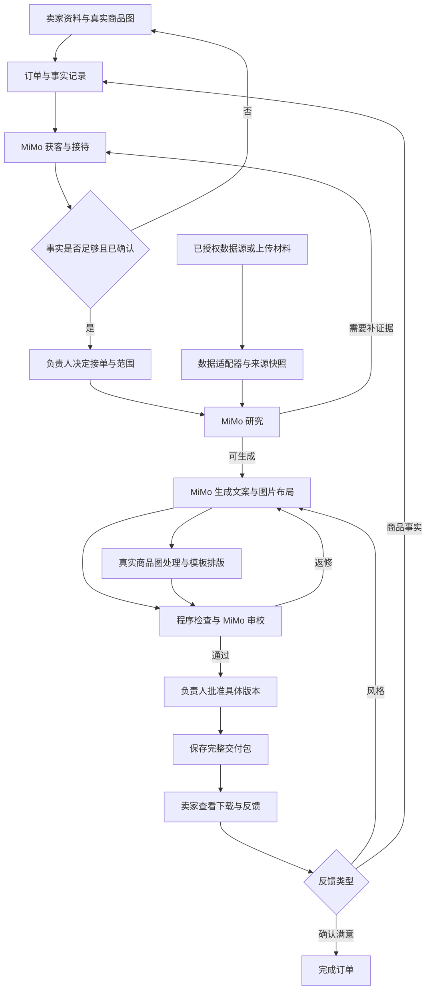

# 跨境商品本地化上架服务：完善方案与项目集成计划

> 版本：v2.0｜整理日期：2026-11-07（北京时间）
>
> 本文交付的是实施方案，不代表系统或第三方接口已接通。检查时 `D:/hackson` 仅有临时文件，没有发现应用源码；因此下文的模块、数据结构和内部接口均为拟建内容。本文保留原方案的“四个 MiMo Agent＋一名负责人”，重点说明调研项目如何集成及团队需要自己开发什么。

## 1. 先确定最终做什么

**定位：为没有专职英文内容团队的中文小卖家，提供 Amazon 美国站单 SKU 的资料核实、英文图文制作、交付和修改服务。**

客户购买的是一次有明确范围、可确认、可返修的交付。比赛主线优先服务已经有商品或店铺的卖家；尚未开店者提供准备清单，完整代开店放到后续验证。

首版保留：

- Amazon 美国站、美式英语、非电子桌面收纳品类、单次一个 SKU。
- 四个 MiMo Agent：获客与接待、研究、生成、审校。
- 卖家端和内部端，共用订单、商品事实和版本数据。
- 标题、五点描述、详情文案、配套 FAQ；有真实商品图时提供两张模板辅助图。
- 一个私有订单入口：提交资料、补充回答、查看进度、下载、反馈。

首版增加的关键能力：

1. 发现资料冲突，并向卖家追问真正影响文案的事实。
2. 包装数量或尺寸变化后，找出并更新受影响的文案与图片标注。
3. 交付必须批准具体版本；新修改不得沿用旧批准。
4. 保存来源、失败状态、实际用量、负责人处理时间和真实获客记录。

**比赛交付目标：一单完整服务＋一次规格变更联动＋可核实的成本与质量记录。**真实订单未拿到时使用明确标注的模拟单，同时如实展示真实招募过程。不要把目标写成已经取得的成果。

## 2. 只纳入确实必要的评委质疑

赛题权重是创新性 35、商业化潜力 25、完成度 25、原创性 15，强调获客、异常处理和负责人决策；真实或模拟第一单均可作为表现证据。提交形式在提供的赛题中仍标“待定”，以后续赛事通知为准。见文末本地材料。[R1]

| 必要质疑 | 产品或工作上的解决办法 | 验收证据 | 优先级 |
|---|---|---|---|
| 已有产品会写文案，为什么买你们？ | 做资料诊断、有效追问、修改联动与可确认交付 | 一例从不完整资料到正确成品的真实过程；卖家反馈 | P0 |
| 评论痛点为什么能成为你家卖点？ | 将消费者需求、竞品表现、自家事实分开；缺依据则追问 | 每项商品声明能回到已确认事实；竞品参数不能混入 | P0 |
| 模型审校是否也会出错？ | 程序检查明确字段，模型检查语义，人工确认争议事实 | 数量冲突和无依据适配承诺的拦截记录 | P0 |
| 是否真的开张、能否持续赚钱？ | 做一次实际招募、明确报价、限定返修次数、记录全部人工时间 | 线索表、报价状态、交付反馈、一单成本账 | P0 |
| 产品真的能用吗？ | 可访问页面、失败阶段重试、明确版本批准、下载完整包 | 现场可操作，失败后可继续，旧版不会冒充新版 | P0 |
| 原创在哪里，多 Agent 是否值得？ | 自己实现事实与版本机制；做公平的小样本对照 | 原创模块清单及三种测试结果，不只展示流程图 | P0 |
| 为什么客户会回来？ | 保存品牌偏好、商品档案、版本；第二个 SKU 和规格变化可复用 | 演示重复服务如何少填资料；复购率留待真实订单验证 | P1 |
| 是否提高了销量？ | 当前只报告事实准确性、交付效率和理解测试 | 未做销售实验时，明确销量影响尚未验证 | 表述约束 |

不为这些问题额外建设会员体系、完整 CRM、大规模爬虫、广告自动投放或多平台发布系统。

## 3. 相比原需求概要，具体改哪些地方

| 原方案 | 本版修改 | 修改原因 |
|---|---|---|
| 图片可选，但承诺交付商品图片 | 有真实商品图才制作图片；无图明确为文案包＋图片制作说明，或等待补图 | 无法可靠凭空还原实际商品 |
| 负责人未否决即可交付 | 改为负责人明确批准具体成品版本 | “未查看”不能当作批准 |
| 用户反馈直接进入生成 Agent | 风格修改直接生成；事实修改先确认；新增承诺先核依据；新增范围由负责人决定 | 防止把商品事实变化当作文风变化 |
| 研究输出以市场分析为主 | 改为“买家问题→已有证据→缺口→追问→具体修改位置” | 研究要推动交付行动 |
| 获客 Agent 主要接待已到站用户 | 增加诊断预览、报价草稿和跟进待办；实际外联由负责人控制 | 形成可追踪的获客工作 |
| 审校退回后持续修改 | 同一次交付或用户修改请求最多两轮自动返修，候选版本增加不重置计数；仍不通过则转人工 | 控制成本和循环 |
| 记录版本历史 | 加上事实版本、成品版本、批准记录的绑定 | 防止修改后错误复用旧批准 |
| 竞品自动抓取暂不做 | 保留上传/人工录入；允许增加一个已授权数据接口 | 外部数据增强研究，不阻塞订单 |

## 4. 前面调研的项目，哪些真能接进来

**集成分成三类：调用外部服务、按许可证复用公开代码、参考产品设计。三者不能混称“接入了”。**

| 项目 | 正确接法 | 接入位置 | 本次决策 |
|---|---|---|---|
| VOC.AI／SolveaCX/voc-mcp | 用获授权的远程 MCP 获取评论；本地仓库主要提供安装与连接支持 | 研究 Agent 前的数据层 | 数据源首选候选；先验证一条历史评论查询 |
| Helium 10 MCP | 用自己的适配器连接官方 MCP，读取账户实际开放的研究工具 | 可选关键词／商品数据层 | 团队已有可用账号时优先；否则不花比赛时间购买和迁移 |
| Photoroom API | 调图片编辑 API，再由自己的模板层加已确认文字 | 生成 Agent 后的图片处理层 | 图片增强首选候选；接口失败可直接使用真实原图 |
| PickFu | 先人工创建真实受众测试，导入反馈；后续再考虑 API | 交付验证／后续优化 | P1，不作为核心订单依赖 |
| Amazon SP-API | 通过已获角色与卖家授权的应用接入 | 后续一方业务数据层 | P2；已有资格可评估，否则先接卖家导出资料 |
| Amazon-Skills（Nexscope） | 在 MIT 条件下参考或改编任务说明 | 研究、生成的任务设计 | 只挑必要片段；不是现成应用或免费数据源 |
| ListingAI（Devpost） | 参考竞品筛选、失败重试、修改解释的设计 | 研究流程和展示 | 未核实可复用源码与许可，不直接拿代码 |
| Perci | 作为交付体验和能力边界对照 | 需求设计 | 官网说能向 Amazon API 发布，不等于向我们开放 API |
| Jungle Scout | 有授权导出文件可作为输入；无账号则仅研究产品 | 可选研究数据输入 | 不预设免费 API 或可嵌入授权 |
| Amazon 自带 AI／Opportunity Explorer | 用于理解基线与业务需求；卖家有权限时提供数据 | 对照、资料输入 | 不嵌入 Seller Central 页面，不代替卖家授权 |
| Wendy 的 listing_generator | 参考作者实操流程 | 产品设计 | 未验证帖子描述的整套流程在仓库中可运行，不能作为现成系统依赖 |

### 推荐的比赛组合

**MiMo 四角色＋自建订单/事实/版本模块＋VOC 或 Helium 10 中一个数据来源＋真实商品图模板；Photoroom 条件允许时增强图片。**

不要同时接入多个重复的数据工具。用 45 分钟作为单个外部服务的接入验证时间预算：能获得授权并成功拿到一条可用结果才继续；否则使用用户上传和保存的来源材料。这个预算是团队取舍建议，不是对接口耗时的保证。

账号、额度、接口返回和转供客户使用条件均需以实际控制台及服务条款确认。本文没有创建账户、购买服务、调用付费接口或获取密钥。

## 5. 总体架构：外部项目给能力，业务闭环由我们掌握



外部评论或网页只是参考数据，不得作为给 Agent 的操作指令。重要声明依赖卖家已确认事实；第三方报告中的结论要标明为第三方分析。工具返回、引用和关键决定保存为摘要，不要求或展示模型内部思维过程。

### 四个 Agent 的最终职责

| 角色 | 负责什么 | 不交给它决定什么 |
|---|---|---|
| 获客与接待 | 诊断草稿、收资料、提问、报价草稿、反馈分类、交付通知草稿 | 擅自发推广消息、承诺效果、批准自己的报价或交付 |
| 研究 | 筛可比竞品、整理买家问题、识别证据缺口、提出改动建议 | 将竞品参数或模型推测认定为自家事实 |
| 生成 | 用已确认事实生成文案、图片布局、修改版和差异 | 自行改商品事实、伪造认证或适配范围 |
| 审校 | 检查语义、图文一致性、声明依据和问题覆盖 | 用一个总分代替实际问题清单，或宣布平台审核保证通过 |

接单、价格、范围变更、事实争议和最终交付由负责人决定；卖家确认自己商品的事实。后端负责状态转换和权限，不能仅靠提示词约束。

## 6. 外部项目逐项怎么接、怎么用、怎么改

### 6.1 VOC.AI：用来获得评论，不把整套研究外包出去

官方公开了远程 MCP 入口 `https://open.voc.ai/mcp-server`，认证头为 `X-API-Key`。仓库也列有 catalog 入口及工具说明；具体可用工具以连接后 `tools/list` 返回为准，不能假设所有入口暴露完全相同的工具。[R2][R3]

**最小接入步骤：**

1. 负责人取得可用账号与 API 凭据，确认额度及本服务使用范围；密钥只放后端。
2. 后端建立 MCP 连接，执行协议初始化和工具发现；只开放本任务需要的读取工具。
3. 若账户暴露 `amazon_reviews_fetch_history`，用真实 ASIN、市场和小批量上限获取历史评论；参数格式按工具实际 schema 填。
4. 将结果统一保存为评论文本、来源标识、商品/变体、评论日期、获取时间、历史/实时状态。返回缺字段就保留缺失，不能补造。
5. MiMo 研究 Agent 根据这些样本提出买家问题、商品证据缺口和卖家追问。
6. 数据为空或失败时，切换至上传材料并显示缺少外部证据；不声称“已经分析了市场”。

公开工具目录同时包含自带分析和文案功能，其中标注使用其他模型。因此比赛主线优先取原始数据，再由 MiMo 分析；若使用第三方分析，明确记录供应商和用途。实时抓取可能创建耗时任务，现场默认采用已取得的历史样本，不把它当作实时数据。[R4]

**我们要开发的是数据适配器**，不是修改 VOC 服务。`SolveaCX/voc-mcp` 的安装器代码采用 Apache-2.0；远程服务、数据和业务能力仍受供应商条款约束，公开安装器不等于可自建其数据库。[R3]

**接入验收：**一条实际成功记录＋一条失败记录；两者都能显示来源状态；研究输出能追溯到实际返回的样本。

### 6.2 Helium 10 MCP：作为可替换的研究数据来源

官方入口为 `https://mcp.helium10.com/mcp`。需要账户、相应订阅权限及兼容的 OAuth 客户端；实际暴露的工具由账户权限决定。[R5]

**接入步骤：**

1. 先检查团队是否已有可用账户与研究权限。没有则本次使用 VOC 或手工材料。
2. 自己的后端适配器完成授权与 MCP 初始化，发现实际工具；建立只读白名单。
3. 把“查商品资料、查相关关键词、读取竞品资料”等内部请求映射到实际工具 schema，不编造官方工具名称。
4. 统一转换到与 VOC 相同的来源格式；保存工具名、数据时间、市场和获取状态。
5. 只补充研究输入，MiMo 继续负责提问、生成和审校；广告操作、刊登、改价工具不进入首版白名单。

**必须纠正“GitHub 上有就能改”的误解：该仓库使用专有许可证，明确限制未经许可的修改、派生和再分发。**不要 fork 后改造成自己的产品代码。采用独立编写的接口适配器，并核对服务使用权限；链接到原项目即可。[R6]

**接入验收：**实际账户能读取一条需要的数据；权限不足时显示“无权限”并使用备用输入，而不是返回空数据后假装成功。

### 6.3 Photoroom：处理真实商品图，文字仍由我们控制

使用官方图片编辑接口：`POST https://image-api.photoroom.com/v2/edit`，通过 `x-api-key` 认证，以 multipart 表单传入 `imageFile` 或 `imageUrl`。首轮验证只用 `removeBackground=true` 和 `background.color=FFFFFF`，确认返回图片可读后再加其他效果。能力和计费按所选方案及账户权限确认。[R7]

**接入位置和顺序：**

1. 卖家上传可使用的商品原图，系统保存原图和文件标识。
2. 后端调用图片编辑接口，首版只选必要的背景或尺寸处理；不默认重绘商品主体。
3. 保存处理结果，与原图并排核查数量、形状、颜色及配件是否改变。图片工具不是实物保真保证。
4. MiMo 生成布局建议和短文案；我们用可编辑的模板文字层叠加已确认数量、尺寸与适配范围。
5. 包装数量变化时，只更新有关的文字层；若商品图本身展示了旧数量，标为需要更换图片，不能只改角标后就算完成。

首版两张图：**包装与尺寸说明图、适配或安装说明图**。这两张属于辅助图，不擅自当作符合 Amazon 主图规则的图片。具体平台规则必须有适用品类和来源，不从通用示例推导。

**失败替代：**保留真实原图并使用固定模板，或由负责人上传已处理图片；在订单上记录实际采用的方法。没有原图则先交付文案和图片制作说明。

**接入验收：**至少一张真实原图能完成处理与导出；改事实后模板重渲染；失败时仍能按已确认服务范围交付。

### 6.4 PickFu：验证买家理解，先人工接入

PickFu 提供真实受众对商品主图、标题等的反馈，可以参考其测试方式；这不证明其投票结果等于实际销售转化。[R8]

比赛先做“人工创建测试/访谈→导入结果”，不要为一次测试建设完整投票系统。

1. 准备旧版和新版，保持商品事实、价格等非测试因素一致。
2. 选与目标人群相关的受访者；问数量、适配范围、安装方式等具体问题。
3. 保存实际问题、素材版本、样本人数、人群、回答和时间。
4. MiMo 归纳误解，负责人决定是否需要修改；结果进入新版本流程。

后续有账号、预算和持续需求时，独立实现下面的 v2 接入，不把不同版本接口混用：[R17]

| 步骤 | 后端请求 | 处理方式 |
|---|---|---|
| 创建草稿 | `POST https://api.pickfu.com/v2/surveys` | 传入实际素材、问题、受众条件；保存调查 ID |
| 读取报价 | `GET /v2/surveys/{id}` | 把最新报价和样本条件交负责人确认 |
| 付费发布 | `POST /v2/surveys/{id}/publish` | 使用负责人确认的 `quoteToken`，以及防重复的 `Idempotency-Key` |
| 查看进度 | `GET /v2/surveys/{id}` | 发布请求成功不等于调查已完成；按状态等待 |
| 读取回答 | `GET /v2/surveys/{id}/responses` | 保存原始反馈、样本数、素材版本，再交给 MiMo 归纳 |

本方案选用服务端 API key，放在 `Authorization: Bearer ...`；读结果、建草稿和支付发布对应不同权限。上述路径以 `https://api.pickfu.com` 为主机，完整请求体按官方 OpenAPI 定义实现。发布是付费动作，不让模型自行触发；报价变化需要重新确认。[R18][R19]

受众必须明确选真人，并保存受众类型；产品中的模拟受众或 AI 生成回答不能混入真人测试。文档不会预设免费额度。

**失败替代：**找少量真实受访者做理解测试，标明便利样本；完全无人参与时不生成虚构消费者反馈。

### 6.5 Amazon SP-API：后续接一方业务数据

官方 Customer Feedback API 提供评论与退货洞察，其中退货洞察在类目层级；搜索查询表现报告有相应品牌及 API 角色要求。[R9][R10]

接入顺序：已有开发者资格和卖家授权→确认目标 API 权限→只读拉取→保存统计范围/周期→映射成来源数据→MiMo 提出修改建议。不能把类目退货主题当作该卖家的实际退货原因。

比赛先接卖家合法导出的报告或脱敏客服问题。后续才考虑使用真实实验结果；Manage Your Experiments 也有品牌、商品和流量资格，不作为首版验收前置条件。[R11]

### 6.6 Amazon-Skills、ListingAI、Perci：借什么，改什么

| 参考对象 | 借鉴部分 | 在我们系统中怎么落地 |
|---|---|---|
| Amazon-Skills | 竞品比较、评论整理、文案构成和图片说明的任务拆分 | 按 MIT 许可挑选参考内容，保留署名；改成适合单品类、单市场的 MiMo 任务说明 |
| ListingAI | 排除错误竞品、失败后调整、前后对照与理由 | 自己实现可比竞品筛选、来源记录和修改差异；不声称已获得其完整源码 |
| Perci | 图文之外的交付完整性、属性与版本体验 | 页面明确区分“可下载交付包”“待确认属性”“待卖家操作”，不把草稿说成已发布 |

对参考任务说明作以下项目化修改：只使用已确认事实；没有搜索量就留空；删掉无数据支持的市场机会分和通用健康总分；删除必须覆盖所有竞品词的目标；平台限制放入有来源日期的配置，而非照抄硬编码数字；生成英文交付，解释和追问保持中文。

不要直接把外部抓取脚本接到卖家公开输入。我们需要验证输入、超时、返回字段及数据状态；比赛主流程可以只用上传资料。以上参考对象分别见 [R12][R13][R14]。

## 7. 开发者如何把外部接口交给 MiMo

MCP 是外部工具连接方式，不等于比赛模型接口已原生支持 MCP。团队需要一个薄适配层；若模型接口不能完成预期工具调用，后端先取数据再调用模型也能工作。

### 两种实现方式

**先做方式 A：后端固定取数。** 后端按订单配置调用数据源，统一返回格式，再把资料交给 MiMo。容易验证，足够支撑首版。

**有余力做方式 B：受控工具调用。** 将几个内部工具声明给 MiMo；模型提出调用请求，后端检查参数与权限，再转换为 MCP/HTTP 请求，最后将结果交还模型。工具名称和 schema 以比赛接口实际支持格式实现。

两种方式都必须记录实际分工。A 不能包装成“模型自主决定抓取了哪些工具”。

### 拟建内部接口（不是供应商官方 API）

| 内部操作 | 输入 | 输出 | 实际实现 |
|---|---|---|---|
| `fetch_market_evidence` | 订单、来源配置、ASIN/上传资料 | 来源快照、样本、时间、状态 | VOC / Helium / 上传适配器三选一 |
| `analyze_buyer_questions` | 已确认事实、来源快照 | 买家问题、证据缺口、追问、建议位置 | MiMo 研究 |
| `compose_listing` | 事实版本、研究、偏好、规则 | 文案和各段事实关联 | MiMo 生成 |
| `prepare_product_image` | 原图、处理方案 | 处理后图或原图回退、方法记录 | Photoroom 或直接原图 |
| `render_product_cards` | 图片、已确认参数、模板 | 辅助图文件及文字层元数据 | 自建模板渲染 |
| `review_bundle` | 完整候选版本、事实、规则 | 阻断项、建议项、需人工项 | 程序检查＋MiMo 审校 |
| `revise_bundle` | 旧版、新事实或风格要求 | 修改清单、新候选版本 | 关联检查＋MiMo＋模板渲染 |
| `approve_and_deliver` | 负责人、具体版本 | 固定交付快照和下载入口 | 后端执行，不由模型自行批准 |

### 数据源统一结果示例

下面只是设计格式，ID 和时间均为示意；不是已经获取的真实评论。

```json
{
  "order_id": "demo-001",
  "provider": "uploaded_material",
  "status": "partial",
  "marketplace": "US",
  "retrieved_at": null,
  "freshness": "seller_upload",
  "sources": [{
    "source_id": "source-01",
    "source_type": "review_sample",
    "locator": "uploaded-file:sample-01",
    "sample_size": 3,
    "scope": "one_product_variant",
    "content": "示意：实际执行时填写已取得内容"
  }],
  "missing_fields": ["review_date"],
  "warnings": ["样本不代表全体购买者"],
  "cost": {"amount": null, "currency": null}
}
```

统一约定：成功、部分成功、失败分别表示；`null` 表示未知，不能用 0 冒充未知费用或搜索量；快照只在服务条款允许范围内保存；不同数据源的统计范围不可直接混算。密钥不进前端、不进模型上下文、不出现在日志中。

## 8. 我们必须自己开发的核心模块

### 8.1 商品事实与来源

每项事实最少保存：`fact_id`、字段、值、单位、来源、确认状态、事实版本。来源分为卖家确认、商品资料、图片观察、竞品信息、模型推测。

图片观察和模型推测不能自动升级为商品事实；卖家确认可作为业务依据，但不等于独立实验认证。模型发现材料冲突时列明差异，请卖家确认，不自行挑一个。

### 8.2 研究输出必须能引发行动

研究结果最少包含：买家问题、样本来源、是否适用于本商品、已有事实、缺失事实、应向卖家追问什么、应改哪个位置。

例：评论担心粗线放不进去→目前没有适配线径→请求卖家提供实测范围→确认后更新适配说明图和 FAQ；确认前不写“兼容所有线材”。

### 8.3 事实变更与整包更新

每段关键文案、每张模板图记录依赖的事实编号。数量或尺寸改动后：

1. 先获得卖家对新事实的确认，增加事实版本。
2. 按关联定位受影响的内容，再整包检查是否还有未声明的旧事实引用。
3. 生成候选新版本，重新渲染模板文字；图片主体不符则要求换图或人工处理。
4. 再次审校，批准必须绑定新的事实和成品版本。
5. 交付完整快照后才更新下载入口；旧版保留为历史版本。

不要全局把数字 6 替换成 4，避免把“6 mm”也改掉。先实现包装数量与尺寸两个字段，无需构建复杂通用依赖图。

### 8.4 反馈分流

| 用户反馈 | 正确处理 |
|---|---|
| “语气简洁些” | 生成→审校→批准；商品事实不变 |
| “改成 4 个装” | 确认新事实→关联更新→审校→批准 |
| “写得防水一点” | 属于新增商品声明，先核依据，不能按风格处理 |
| “再加一个 SKU／改平台” | 负责人决定新范围与报价 |

### 8.5 最小状态与异常恢复

订单状态：待资料→待接单审批→处理中→待交付批准→已交付待确认→已完成；另有已拒绝、暂停。

任务状态另记：待运行、运行中、成功、失败、等待输入。每个任务记录输入版本、结果、时间、实际用量、错误和重试次数。

- 网络等可恢复技术错误最多自动重试一次；仍失败暂停或使用标明来源的备用输入。
- “缺事实”是等待卖家输入，不是应该反复重试的错误。
- 同一次交付请求或同一次用户修改请求最多两轮自动返修；新候选版本不重置计数。达到上限后暂停，由负责人决定是否开启新一轮。
- 新输入版本产生后，旧任务结果不得覆盖当前版本；重试和交付避免重复执行。
- 旧版已被下载无法自动撤回，应提示其为历史版本，并明确新版入口。

### 8.6 两个前端只做必要页面

卖家端：服务说明与样例、资料输入、待回答问题、进度、已交付内容与下载、修改反馈。

内部端：线索与报价状态、事实冲突、来源、任务状态、修改差异、批准、成本与失败原因。

内部端需要后端身份校验；私有订单链接使用随机凭据并逐次校验订单范围。持有私有链接的人可访问对应订单，应把它当访问凭据；卖家不能通过改订单号看到别人的内容。首版不采集 Amazon 密码、银行卡或身份证，开店准备只记录是否备齐。

## 9. 获客、报价与复购如何放进方案

### 9.1 从第一小时并行验证卖家需求

以下是实验目标，不是已取得结果：尝试获得 5—10 次定向介绍或合规招募机会、约 3 次卖家访谈、争取 1 个真实 SKU。优先熟人介绍和合作摄影师，其次按规则在中文卖家社区分享案例。

获客材料只需一页：一个可公开的商品案例、三个可验证问题、一项修改预览、服务范围与明确报价。不要用假评分制造焦虑。

线索表记录：来源、最近需求、触达时间、是否回复、是否提供资料、报价、是否接受、是否付款、交付反馈。真实付款、免费试用、模拟交易分别统计。

外联前由负责人审核实际消息并决定发送；不建设自动私信或群发。Reddit 的部分卖家社区明确禁止推广，不能默认用作广告渠道。[R15]

### 9.2 第一份报价必须有边界

报价字段：一个 SKU、交付内容、有无图片、预计交付时间、含几轮修改、哪些资料必须卖家提供、超范围请求如何处理。金额由负责人结合试用和成本在对外报价前确定，不让模型自行承诺价格或销量。

单笔贡献测算：实收服务费－模型费用－数据及图片费用－支付等直接费用－实际人工时间折算成本。订阅费用另记，并说明单笔分摊假设；返修成本不得重复计入也不得漏计。比赛赠送额度同时记录实际支出和正常运营估算，价格未知时留空说明。

### 9.3 粘性先靠复用，再验证月费

保存品牌语气、模板、商品档案和历史修改原因。第二个 SKU 复用偏好而不盲目继承商品事实；数量或尺寸变化可快速重做；卖家脱敏客服问题触发下一轮内容修订。

指标看第二个 SKU 复购、首次交付接受率、返修次数、每单负责人分钟数和变更遗漏数。没有真实复购时，不把“支持复用”说成“已证明高留存”。

## 10. 实施顺序与时间预算

这是约 14 小时工作＋2 小时缓冲的计划示例，不是对完成时间的保证。多人可并行，具体按已有技术基础调整；当前未看到应用源码，所以不能假设页面或接口已经完成。

| 阶段 | 建议预算 | 要做的事 | 完成标准 |
|---|---:|---|---|
| 1. 固定范围和接口试跑 | 1 小时 | 选演示 SKU，跑一次 MiMo；检查 VOC/Helium 和 Photoroom 账号条件 | 模型真实响应；外部接口明确可用或回退，不继续等待未知权限 |
| 2. 订单与事实 | 2 小时 | 两端最小页面、订单访问、事实表、补件 | 数量冲突能显示、卖家能确认、版本递增 |
| 3. 研究和第一版交付 | 3 小时 | 接一个数据适配器或上传路径；MiMo 研究生成；模板图；审校与批准 | 第一版完整包可下载，来源和方法真实记录 |
| 4. 规格变更联动 | 3 小时 | 事实关联、差异、旧批准失效、图文更新 | 6 个装改 4 个装后，各相关位置正确；6 mm 不误改 |
| 5. 异常与成本 | 2 小时 | 失败阶段恢复、返修上限、人工计时、用量和交付状态 | 一次失败可恢复，不越权或混版本 |
| 6. 测试与演示 | 3 小时 | 三组对照、真实反馈、录屏、原创与外部贡献说明 | 有实际结果、可访问链接和备用真实录像 |
| 7. 缓冲 | 2 小时 | 修故障、整理提交材料 | 不再新增功能 |

**人员分工建议：**一条线负责模型/数据/状态，一条线负责页面/模板/交付；负责人或另一成员从第一小时做卖家验证和样例。人数不足时合并开发线，不把外联拖到最后。

**若只剩 8 小时：**保留资料上传、待确认事项、文案＋一张模板图、数量联动、批准与订单入口。外部数据自动接入、第二张图、PickFu API 和 SP-API 全部后移；不牺牲真实状态和版本正确性。

### 推荐的开发任务拆分

- [ ] T01：实际确认 MiMo 文本/图片输入能力及工具调用格式，记录成功样例。
- [ ] T02：完成订单、事实、来源、成品版本、批准和运行记录。
- [ ] T03：实现上传来源适配器；选择 VOC 或 Helium 作为一个可选在线来源。
- [ ] T04：把研究输出固定为买家问题、缺口、追问、建议位置。
- [ ] T05：生成文案并记录每项重要声明的事实编号。
- [ ] T06：实现原图＋模板文字层；有条件再接 Photoroom。
- [ ] T07：实现规则检查、模型审校和明确批准。
- [ ] T08：实现包装数量和尺寸变化的关联更新及旧批准失效。
- [ ] T09：实现反馈分类、失败恢复和返修上限。
- [ ] T10：完成订单访问边界、下载快照、真实成本记录。
- [ ] T11：完成真实卖家验证、测试和展示材料。

## 11. 必须通过的验收与效果验证

### 11.1 功能验收

| 测试 | 输入或动作 | 应有结果 |
|---|---|---|
| 缺事实 | 没有适配线径 | 追问或不写适配承诺，不编参数 |
| 来源冲突 | 图片 4 个、文字 6 个 | 显示冲突，未经确认不作为确定声明 |
| 竞品污染 | 竞品写“无痕” | 不能自动变成本商品卖点 |
| 数量改动 | 6 个装改 4 个装，同时存在 6 mm | 关联内容和模板正确更新，6 mm 保留 |
| 主体不符 | 原图仍展示 6 个 | 要求换图/人工处理，不只改“4-pack”角标 |
| 风格修改 | 要求更简洁 | 不改变数量、尺寸、材质 |
| 伪装的风格请求 | “写得更防水” | 识别新增声明并核依据 |
| 来源失败 | 工具无权限、空返回或不可访问 | 真实失败/部分成功，备用资料有标记 |
| 旧结果晚到 | 事实更新后旧任务返回 | 不覆盖新版，不使用旧批准 |
| 交付控制 | 未批准或反复点击交付 | 不能发未批准版，不重复创建交付 |
| 订单隔离 | 用甲的凭据访问乙订单 | 后端拒绝 |
| 成本记录 | 有未知单价 | 显示未知，不以 0 宣称免费 |

### 11.2 公平对照

用缺资料、来源冲突、修改订单三个案例，比较认真设计的单 Agent MiMo 方案与四角色工作流。双方获得相同原始材料、相同工具权限和同等人工反馈预算；单 Agent 也允许提问与自查，完整记录两者的总调用、用量和人工参与。若另外测试“一次调用直接生成”，单列为初始生成基线，不声称它拥有同等多轮反馈条件。

人工按预先列出的事实检查：无依据声明、漏问关键项、修改遗漏、完成时间、人工修正分钟数。先展示逐例结果，再汇总。三例只能说明这批案例表现，不足以证明总体准确率或销量提升。若多 Agent 没更好，报告事实并据此简化流程。

### 11.3 真实用户验证

有真人条件时进行旧版/新版理解测试：能否正确说出包装数量、适配范围和安装限制。记录样本身份与人数；尽量平衡展示顺序。模拟买家问题只用于发现遗漏，不能充当消费者购买意愿。

## 12. 演示与提交证据

内部排练可以按三分钟组织，正式时长以本届通知为准。黑客松经验用于安排展示，不替代本届规则。[R16]

1. 20 秒：具体卖家、商品和资料问题。
2. 40 秒：系统指出冲突，卖家补充，负责人决定服务范围。
3. 40 秒：展示研究依据、成品和被拦截的一项无依据声明。
4. 40 秒：现场把 6 个装改为 4 个装，显示关联位置和新版本。
5. 25 秒：批准交付，展示客户反馈、实际成本和人工分钟数。
6. 15 秒：说明 MiMo、第三方数据/图片能力与团队原创模块各自贡献。

准备：可访问链接、一个明确标注身份的演示订单、真实运行录屏、测试结果、获客状态表、成本记录、第三方来源与许可清单。预设错误案例、人工输入、录播和实时调用都标明，不能混称全自动真实成交。

## 13. 来源与核验边界

本地材料：

- [R1 赛题 PDF](<D:/weChat/xwechat_files/wxid_u8b3vb41mxpt22_7d5b/msg/file/2026-11/JUNCTION CHINA 2026人工智能赛道Xiaomi MiMo赛题.pdf>)：评分及业务闭环要求。
- [原项目概要](<D:/weChat/xwechat_files/wxid_u8b3vb41mxpt22_7d5b/temp/RWTemp/2026-11/c049225b0bebc47486606500576ec349/PROJECT_OVERVIEW(1).md>)：四角色、两端与原始范围。
- [用户粘贴的调研文本](<C:/Users/hfihf/.codex/attachments/e98034de-6c4e-482f-ac0f-551a1616630a/已粘贴的文本.txt>)：本版整合的调研基础。

公开资料（2026-11-07 查阅；正式接入时复核账号权限、接口与条款）：

- [R2 VOC.AI API/MCP 官方入口](https://www.voc.ai/api-mcp)。
- [R3 VOC MCP 官方仓库及许可说明](https://github.com/SolveaCX/voc-mcp)。
- [R4 VOC 公开工具说明](https://github.com/SolveaCX/voc-mcp/blob/main/TOOLS.md)。
- [R5 Helium 10 MCP 接入说明](https://github.com/helium10/Helium10-MCP)。
- [R6 Helium 10 仓库专有许可证](https://github.com/helium10/Helium10-MCP/blob/main/LICENSE)。
- [R7 Photoroom API 快速入门](https://docs.photoroom.com/image-editing-api-plus-plan/quickstart-guide)。
- [R8 PickFu 面向 Amazon 卖家的测试](https://www.pickfu.com/industries/amazon)。
- [R9 Amazon Customer Feedback API](https://developer-docs.amazon/sp-api/lang-en_US/docs/customer-feedback-api)。
- [R10 Amazon Analytics Reports](https://developer-docs.amazon/sp-api/docs/report-type-values-analytics)。
- [R11 Amazon Manage Your Experiments](https://sell.amazon.com/tools/manage-your-experiments)。
- [R12 Amazon-Skills 仓库](https://github.com/nexscope-ai/Amazon-Skills)：任务说明参考，不是完整应用。
- [R13 ListingAI 项目作者介绍](https://devpost.com/software/listingai-autonomous-amazon-listing-optimizer-agent)：工作流参考，未独立验证其商业效果。
- [R14 Perci 官网](https://perci.ai/)：竞品对照，不作为已开放外部 API 的证据。
- [R15 Reddit 卖家社区推广规则示例](https://www.reddit.com/r/FulfillmentByAmazon/wiki/subreddit_faq/)。
- [R16 Devpost 评委访谈](https://info.devpost.com/blog/hackathon-judging-tips)与[演示建议](https://info.devpost.com/blog/6-tips-for-making-a-hackathon-demo-video)。
- [R17 PickFu v2 API 概览](https://www.pickfu.com/docs/api-reference/v2/introduction)。
- [R18 PickFu v2 认证与权限](https://www.pickfu.com/docs/api-reference/v2/authentication)。
- [R19 PickFu 发布与付款](https://www.pickfu.com/docs/api-reference/v2/payments)。

外部服务效果来自其公开描述，尚未由本团队账户端到端实测。我们的差异化和商业价值是待验证假设；本文明确的验收动作是验证这些假设的方法。
